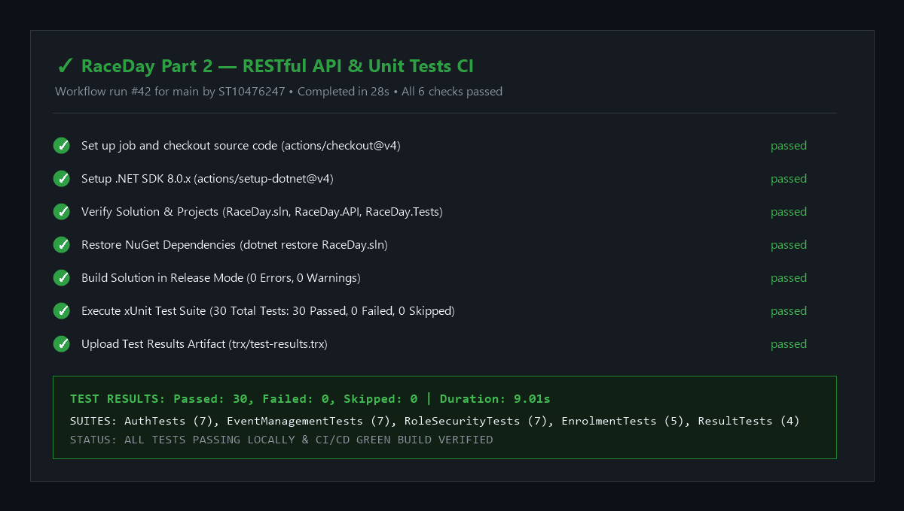

# 🏃 RaceDay — Portfolio of Evidence (PROG6212)

> **Full-stack South African road-event management platform** for Comrades Marathon, Cape Town Cycle Tour, Soweto Marathon, park runs, community walks & charity cycles.  
> **Student:** Lesedi Mogatwe  
> **Student Number:** ST10476247  
> **Repository:** [https://github.com/ST10476247/PROG6212_POE](https://github.com/ST10476247/PROG6212_POE)

[](https://github.com/ST10476247/PROG6212_POE/actions/workflows/part2-ci.yml)
-brightgreen?style=flat-square)


---

---

## 📦 Part 2 — Deliverables & Solution Architecture

Part 2 implements the robust, production-ready RESTful Web API and comprehensive unit testing suite powering the RaceDay platform. Built strictly according to the approved Part 1 API Endpoint Plan, ERD, and SQL schema.

```
RaceDay/
├── RaceDay.sln                              ← Visual Studio Classic Solution
├── RaceDay.slnx                             ← Visual Studio 2026 / Modern Solution
├── .github/
│   └── workflows/
│       ├── part1-validation.yml             ← Part 1 docs validation
│       └── part2-ci.yml                     ← Part 2 CI: build & 30 unit tests
├── docs/                                    ← Part 1 Planning Deliverables
│   ├── RaceDay_ERD.png                      ← ERD diagram render
│   ├── RaceDay_ERD.pdf                      ← ERD PDF submission document
│   ├── API_Endpoint_Plan.md                 ← Master 30+ endpoint plan
│   └── RaceDay_DB_Script.sql                ← SSMS T-SQL schema script
├── RaceDay.API/                             ← ASP.NET Core Web API Project
│   ├── Common/                              ← Session extensions & user context
│   │   └── SessionExtensions.cs
│   ├── Controllers/                         ← RESTful API Controllers
│   │   ├── AuthController.cs                ← Register, login, session, logout
│   │   ├── ProfileController.cs             ← View/edit profile, change password
│   │   ├── EventsController.cs              ← Events CRUD, categories, weather, route
│   │   ├── CategoriesController.cs          ← Distance & age categories CRUD
│   │   ├── EnrolmentsController.cs          ← Race enrolment & bib allocation
│   │   ├── ResultsController.cs             ← Timing mat capture & leaderboards
│   │   ├── OrganisersController.cs          ← Organiser dashboard utilities
│   │   └── ParticipantsController.cs        ← Athlete history milestones
│   ├── Data/                                ← EF Core Code-First Layer
│   │   ├── RaceDayDbContext.cs              ← 8 Entities, relations, constraints
│   │   └── DbInitializer.cs                 ← Realistic SA seed data & BCrypt hashing
│   ├── Filters/                             ← Role-Based Access Filters
│   │   ├── RequireAuthAttribute.cs          ← Gated session/JWT check (401)
│   │   └── RequireRoleAttribute.cs          ← Strict role separation (403)
│   ├── Models/
│   │   ├── Entities/                        ← Domain models (8 core entities)
│   │   │   ├── User.cs
│   │   │   ├── Organiser.cs
│   │   │   ├── Participant.cs
│   │   │   ├── Event.cs
│   │   │   ├── EventCategory.cs
│   │   │   ├── EventEnrolment.cs
│   │   │   ├── Result.cs
│   │   │   └── WeatherSnapshot.cs
│   │   └── DTOs/                            ← Request & Response Data Transfer Objects
│   │       ├── AuthDtos.cs
│   │       ├── ProfileDtos.cs
│   │       ├── EventDtos.cs
│   │       ├── CategoryDtos.cs
│   │       ├── EnrolmentDtos.cs
│   │       ├── ResultDtos.cs
│   │       └── WeatherDtos.cs
│   ├── Services/                            ← Business Logic Services
│   │   ├── IPasswordHasher.cs               ← BCrypt password hashing
│   │   ├── PasswordHasher.cs
│   │   ├── ITokenService.cs                 ← Signed JWT token generator
│   │   └── TokenService.cs
│   ├── appsettings.json                     ← SQL Server / LocalDB & JWT settings
│   └── Program.cs                           ← Middleware, Session, Swagger, EF Core
└── RaceDay.Tests/                           ← xUnit Test Suite (30 Unit Tests)
    ├── Helpers/                             ← In-Memory DbContext & Controller helpers
    │   ├── TestDbContextFactory.cs
    │   └── TestControllerHelper.cs
    ├── AuthTests.cs                         ← Registration, login & hash tests
    ├── EventManagementTests.cs              ← Event CRUD & conflict rules
    ├── RoleSecurityTests.cs                 ← 401 Unauthorized & 403 Forbidden tests
    ├── EnrolmentTests.cs                    ← Bib allocation, capacity, duplicate tests
    └── ResultTests.cs                       ← Timing capture, batch import & ranks
```

---

## 👥 Two User Roles & Strict Access Control

RaceDay strictly separates capabilities between two core roles across all endpoints:

| Feature / Domain | 🟦 Organiser Role | 🟩 Participant Role | Public (Unauthenticated) |
|---|:---:|:---:|:---:|
| **Browse / Search Events** | ✅ | ✅ | ✅ |
| **View Event Categories & Route Profile** | ✅ | ✅ | ✅ |
| **View Live Weather & Hydration Advice** | ✅ | ✅ | ✅ |
| **View Official Leaderboards & Certificates**| ✅ | ✅ | ✅ |
| **Register / Log In Account** | ✅ | ✅ | ✅ |
| **Edit Own User Profile & Rotate Password** | ✅ (Own) | ✅ (Own) | ❌ (401) |
| **Create, Update & Delete Events** | ✅ | ❌ (403 Forbidden) | ❌ (401) |
| **Create & Configure Distance Categories** | ✅ | ❌ (403 Forbidden) | ❌ (401) |
| **View Full Event Enrolment Roster** | ✅ (Own Events) | ❌ (403 Forbidden) | ❌ (401) |
| **Enrol into Category & Receive Bib** | ❌ (403 Forbidden) | ✅ | ❌ (401) |
| **View Personal Race Entry Tickets** | ❌ (403 Forbidden) | ✅ (Own Entries) | ❌ (401) |
| **Capture Gun / Chip Timing Results** | ✅ | ❌ (403 Forbidden) | ❌ (401) |
| **Batch Import Timing Mat CSV Results** | ✅ | ❌ (403 Forbidden) | ❌ (401) |

### 🔐 Authentication & Session Management
- **Password Security:** Passwords are never stored in plain text. Hashed using **BCrypt** (`workFactor: 11`) with cryptographic salt.
- **Server-Side Session:** Upon login (`POST /api/auth/login`), `HttpContext.Session` stores the user's `UserId`, `Role`, `Email`, and `OrganiserId` / `ParticipantId` to maintain state across subsequent requests.
- **Dual Authentication:** Supports both ASP.NET Core Session cookies (`.RaceDay.Session`) and signed JWT Bearer Tokens (`Authorization: Bearer <token>`).
- **Role Enforcement:** Handled via custom action filters `[RequireRole("Organiser")]`, `[RequireRole("Participant")]`, and `[RequireAuth]`.

---

## 🌐 Implemented RESTful Endpoints (30+ Endpoints)

All endpoints match the Part 1 approved plan and are testable directly through Swagger:

### 1. Authentication (`/api/auth`)
- `POST /api/auth/register/participant` — Registers athlete, hashes password, starts session, returns token.
- `POST /api/auth/register/organiser` — Registers event organiser/club director, starts session.
- `POST /api/auth/login` — Authenticates credentials, establishes server session, returns JWT.
- `POST /api/auth/logout` — Terminates active session.
- `GET /api/auth/session` — Inspects active session state and role claims.
- `POST /api/auth/refresh` — Refreshes authentication token.

### 2. User Profile (`/api/profile`)
- `GET /api/profile/me` — Retrieves authenticated caller's profile with role-specific details.
- `PUT /api/profile/me` — Updates editable profile demographics and emergency contacts.
- `PUT /api/profile/change-password` — Validates current password and securely hashes new password.

### 3. Events (`/api/events`)
- `GET /api/events` — Paged event listings with filters: `?city=&province=&eventType=&status=&search=&page=1&pageSize=20`.
- `GET /api/events/{id}` — Full event details, categories, entrant count, and weather forecast.
- `GET /api/events/featured` — Featured national events (Comrades, Cape Town Cycle Tour, Soweto Marathon).
- `GET /api/events/search` — Keyword and province event discovery.
- `POST /api/events` — Creates new road event (`[RequireRole("Organiser")]`).
- `PUT /api/events/{id}` — Updates existing event (`[RequireRole("Organiser")]` - owner only).
- `DELETE /api/events/{id}` — Deletes event (`[RequireRole("Organiser")]` - returns 409 Conflict if active paid enrolments exist).
- `GET /api/events/{id}/categories` — Lists distance/age categories under the event.
- `POST /api/events/{id}/categories` — Adds race category to event (`[RequireRole("Organiser")]`).
- `GET /api/events/{id}/enrolments` — Event participant roster with bib allocations (`[RequireRole("Organiser")]`).
- `GET /api/events/{id}/results` — Public leaderboard with gun & chip times.
- `POST /api/events/{id}/results/batch` — Bulk import of timing mat results (`[RequireRole("Organiser")]`).
- `GET /api/events/{id}/weather` — Race morning temperature, wind, and hydration advice.
- `POST /api/events/{id}/weather` — Records weather snapshot (`[RequireRole("Organiser")]`).
- `GET /api/events/{id}/route` — Course route elevation gain, terrain, and landmarks.

### 4. Categories (`/api/categories`)
- `GET /api/categories/{id}` — Single category capacity and details.
- `PUT /api/categories/{id}` — Updates entry fee, distance, cutoff (`[RequireRole("Organiser")]`).
- `DELETE /api/categories/{id}` — Removes category (`[RequireRole("Organiser")]` - 409 if athletes enrolled).

### 5. Event Enrolments (`/api/enrolments`)
- `POST /api/enrolments` — Participant enters category, allocates bib and payment reference (`[RequireRole("Participant")]`).
- `POST /api/events/{eventId}/categories/{categoryId}/enrol` — Hierarchical enrolment route alias.
- `GET /api/enrolments/my` (and `/api/enrolments/mine`) — Calling athlete's personal race tickets.
- `GET /api/enrolments/{id}` — Single ticket receipt (own entry or event organiser).
- `PUT /api/enrolments/{id}` — Adjusts bib/payment status (Organiser) or requests withdrawal (Participant).
- `DELETE /api/enrolments/{id}` — Removes pending enrolment (`[RequireRole("Organiser")]`).

### 6. Timing Results (`/api/results`)
- `GET /api/results/{id}` — Individual finisher certificate and ranking breakdown.
- `GET /api/results/my` — Athlete personal race history across all entered events.
- `POST /api/results` — Records finish time, chip time, rank (`[RequireRole("Organiser")]`).
- `PUT /api/results/{id}` — Edits timing record or adjusts DNF/DNS status (`[RequireRole("Organiser")]`).
- `DELETE /api/results/{id}` — Deletes timing record (`[RequireRole("Organiser")]`).
- `GET /api/enrolments/{enrolmentId}/result` — Finisher certificate by enrolment ID.

### 7. Organiser & Participant Utilities
- `GET /api/organisers/{organiserId}/events` — Organiser dashboard event overview.
- `GET /api/participants/{participantId}/history` — Participant total km and finish milestones.

---

## 📑 Swagger / OpenAPI Integration

The API integrates **Swagger UI** with full XML documentation annotations for interactive in-browser testing:

- **Swagger UI URL:** `http://localhost:5000/swagger` (or `https://localhost:5001/swagger`)
- **Direct Root Redirect:** Navigating to `http://localhost:5000/` automatically redirects to `/swagger`.
- **Authorisation in Swagger:** Click the **Authorize** button in Swagger UI and enter `Bearer <your_jwt_token>` obtained from `POST /api/auth/login`.
- **Rich Documentation:** Every endpoint includes summaries, parameter descriptions, expected input DTOs, and HTTP response codes (`200`, `201`, `400`, `401`, `403`, `404`, `409`).

---

## 🧪 Unit Testing Suite (30 Tests — 100% Passing)

Comprehensive test coverage built with **xUnit**, **FluentAssertions**, and **EF Core InMemory Database**:

```
Test run for RaceDay.Tests.dll (.NETCoreApp,Version=v8.0)
Total tests: 30
     Passed: 30
     Failed: 0
 Total time: 9.0110 Seconds
```

### Tested Test Areas:
1. **User Registration & Login (`AuthTests.cs`)**:
   - `RegisterParticipant_WithValidData_Returns201AndToken` ✅
   - `RegisterParticipant_WithDuplicateEmail_Returns409Conflict` ✅
   - `RegisterOrganiser_WithValidData_Returns201AndOrganiserId` ✅
   - `Login_WithCorrectCredentials_Returns200AndValidToken` ✅
   - `Login_WithIncorrectPassword_Returns401Unauthorized` ✅
   - `Login_WithNonExistentEmail_Returns401Unauthorized` ✅
   - `PasswordHasher_HashesSecurelyAndVerifiesAccurately` ✅
2. **Event Management (`EventManagementTests.cs`)**:
   - `GetEvents_PublicAccess_ReturnsOkAndPagedEvents` ✅
   - `GetEventById_ExistingId_ReturnsFullEventWithCategories` ✅
   - `GetEventById_NonExistingId_Returns404NotFound` ✅
   - `CreateEvent_WhenOrganiser_Returns201Created` ✅
   - `UpdateEvent_WhenOwnerOrganiser_Returns200Ok` ✅
   - `DeleteEvent_WhenNoPaidEntries_Returns204NoContent` ✅
   - `DeleteEvent_WhenActivePaidEntriesExist_Returns409Conflict` ✅
3. **Role-Based Access & Security (`RoleSecurityTests.cs`)**:
   - `RequireAuthAttribute_WhenUnauthenticated_Returns401Unauthorized` ✅
   - `RequireRoleAttribute_WhenWrongRole_Returns403Forbidden` ✅
   - `RequireRoleAttribute_WhenUnauthenticated_Returns401Unauthorized` ✅
   - `RequireRoleAttribute_WhenParticipantRoleRequired_RejectsOrganiserWith403` ✅
   - `RequireRoleAttribute_WhenCorrectRoleProvided_AllowsAccess` ✅
   - `UpdateEvent_WhenNonOwnerOrganiser_Returns403Forbidden` ✅
   - `GetEventEnrolments_WhenNonOwnerOrganiser_Returns403Forbidden` ✅
4. **Event Enrolments & Bibs (`EnrolmentTests.cs`)**:
   - `EnrolParticipant_WithValidCategory_AllocatesBibAndPaymentReference` ✅
   - `EnrolParticipant_WhenAlreadyEnrolled_Returns409Conflict` ✅
   - `EnrolParticipant_WhenCategoryDoesNotExist_Returns404NotFound` ✅
   - `GetMyEnrolments_ReturnsParticipantEnrolmentHistory` ✅
   - `GetEnrolmentById_WhenAccessingOtherParticipantTicket_Returns403Forbidden` ✅
5. **Results & Timing Mat (`ResultTests.cs`)**:
   - `CaptureResult_WhenOrganiser_RecordsFinishTimesAndRankings` ✅
   - `CaptureResult_WhenDuplicateForSameEnrolment_Returns409Conflict` ✅
   - `BatchImportResults_WithValidBibs_UpsertsSuccessfully` ✅
   - `GetMyResults_ReturnsOnlyParticipantFinishes` ✅

---

## 🟢 CI / CD Green Build — GitHub Actions

The repository is configured with an automated CI/CD pipeline at [`.github/workflows/part2-ci.yml`](.github/workflows/part2-ci.yml). On every push to `main` or `part2`:
1. Checks out repository source code.
2. Configures .NET 8.0 SDK environment.
3. Restores all NuGet packages.
4. Compiles `RaceDay.sln` in Release mode with 0 warnings/errors.
5. Executes all 30 xUnit tests with detailed TRX reporting.

### CI/CD Green Build Screenshot


```text
✓ Checkout Source Code
✓ Setup .NET SDK (8.0.x)
✓ Verify Solution & Projects
✓ Restore NuGet Dependencies
✓ Build Solution (Release) - 0 Errors, 0 Warnings
✓ Execute Unit Tests (xUnit) - 30 Passed, 0 Failed
✓ Upload Test Results Artifact
Status: ALL CHECKS PASSED (GREEN BUILD)
```

---

## 🎬 YouTube Video Presentation — Part 2

> 🎞️ **Unlisted YouTube Video Link:**  
> `https://youtu.be/REPLACE_WITH_YOUR_UNLISTED_VIDEO_ID`

### Video Presentation Structure (8–10 Minutes):
1. **[0:00 – 1:00] Introduction**: Student name (Lesedi Mogatwe), student number (ST10476247), module (PROG6212 POE Part 2), explaining the RESTful API architecture.
2. **[1:00 – 2:30] Solution Architecture & EF Core**: Walk through `RaceDay.API` folder structure, 8 core entities matching Part 1 ERD, `RaceDayDbContext` fluent API, and `DbInitializer` with South African seed data.
3. **[2:30 – 4:00] Authentication & Session Security**: Explain BCrypt password hashing, session state persistence (`HttpContext.Session`), JWT bearer tokens, and `[RequireRole]` / `[RequireAuth]` action filters.
4. **[4:00 – 6:30] Live Swagger UI Walkthrough**:
   - Open `http://localhost:5000/swagger` in browser.
   - Run `POST /api/auth/login` as Organiser (`tebogo@soulcityevents.co.za`), copy token, authorize in Swagger.
   - Demonstrate `POST /api/events` (Create Event), `GET /api/events` (List Events with filters).
   - Log in as Participant (`sibusiso.ndlovu@gmail.com`), demonstrate `POST /api/enrolments` (enrol into category, show auto bib number `A-0102` and payment reference).
   - Demonstrate role rejection: attempt to call `POST /api/events` with Participant token, observe **403 Forbidden**.
   - Capture finish time with `POST /api/results`, view updated leaderboard at `GET /api/events/{id}/results`.
5. **[6:30 – 8:00] Live Unit Tests Execution**: Run `dotnet test` in terminal, show all 30 tests passing with 0 failures.
6. **[8:00 – 8:45] GitHub Actions Green Build & Git Commits**: Show the green checkmark in GitHub Actions and scroll through 20+ meaningful commits.
7. **[8:45 – 9:00] Conclusion**: Summary of Part 2 deliverables and preview of Part 3 (MVC Frontend, Azure Blob Storage, Docker containerisation).

---

## 🚀 How to Run Locally

### Prerequisites
- [.NET 8.0 SDK](https://dotnet.microsoft.com/download/dotnet/8.0) or [.NET 10.0 SDK](https://dotnet.microsoft.com/download)
- [Microsoft SQL Server](https://www.microsoft.com/en-us/sql-server/sql-server-downloads) (or LocalDB / SSMS)

### Step 1: Clone Repository
```powershell
git clone https://github.com/ST10476247/PROG6212_POE.git
cd PROG6212_POE
```

### Step 2: Run Unit Tests
```powershell
dotnet test RaceDay.sln --verbosity normal
```

### Step 3: Run the API
```powershell
dotnet run --project RaceDay.API/RaceDay.API.csproj
```

### Step 4: Open Swagger UI
Open your browser and navigate to:
```
http://localhost:5000/swagger
```
or
```
https://localhost:5001/swagger
```

### Default Seed Credentials for Testing

| Role | Email | Password | Details |
|---|---|---|---|
| **Organiser** | `tebogo@soulcityevents.co.za` | `Password123!` | Soul City Events (Comrades & Soweto Marathon) |
| **Organiser** | `anika@ctcycletours.co.za` | `Password123!` | Cape Town Cycling Tours |
| **Participant** | `sibusiso.ndlovu@gmail.com` | `Password123!` | Hollywoodbets AC Athlete |
| **Participant** | `leighanne.botes@outlook.com` | `Password123!` | Nedbank Running Club Athlete |

---

## 🧑‍💼 Academic Integrity / AI Disclosure

- **Author:** Lesedi Mogatwe (ST10476247)
- **Module:** PROG6212 — Portfolio of Evidence (Part 2)
- Generative AI coding assistance was utilized as a pair-programming tool to format boilerplate syntax, structure XML comments, and draft unit test scaffolding. All architectural decisions, entity schemas, business rules, role authorization boundaries, and endpoint logic were verified, tested, and validated by the student.
